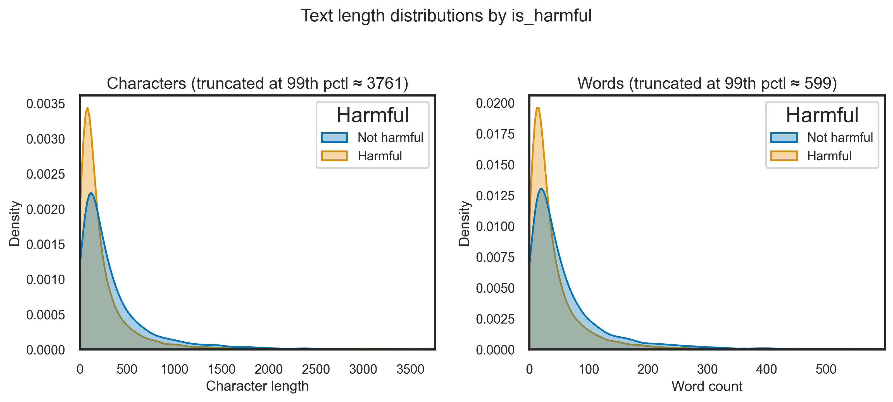
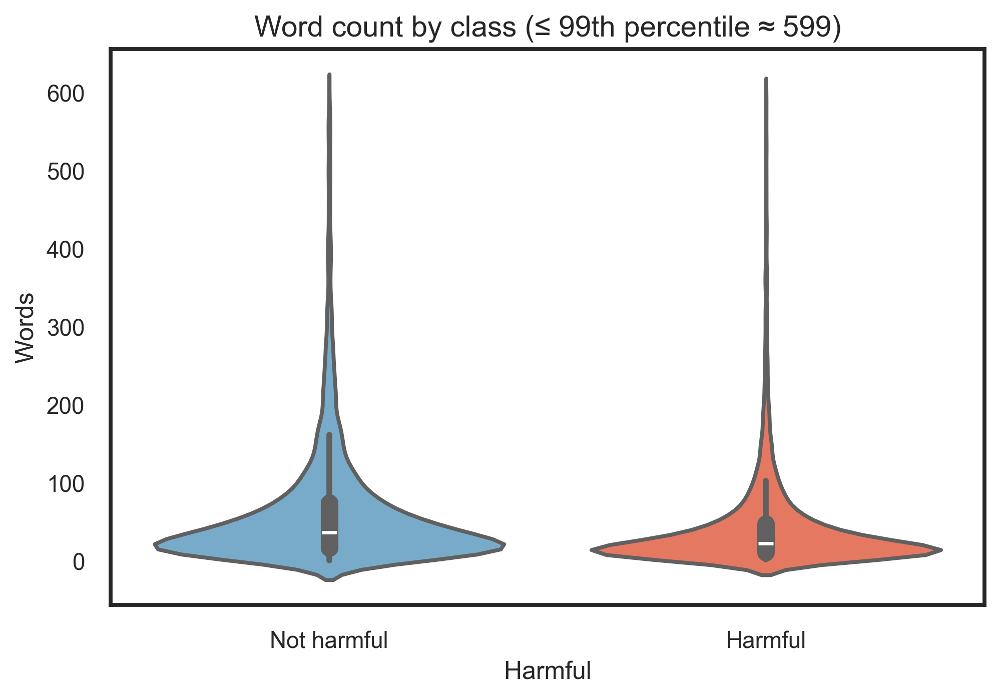
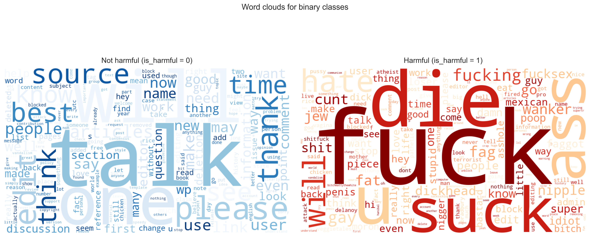

# NLP-Based Harmful Comment Detection

**Binary text classification for online content moderation | UTS academic group project (42850 Natural Language Processing Algorithms, Autumn 2026)**

This project investigates whether natural language processing (NLP) models can distinguish harmful from non-harmful online comments. Using a **balanced sample of 20,000 comments** derived from the Jigsaw Toxic Comment Classification Challenge, we explored the data, prepared text for modelling, and compared five neural and transformer-based approaches.

**Best reported test result — DistilBERT: 94.1% accuracy | 0.941 F1-score | 0.985 ROC-AUC.** These figures come from the team's project report, not from a live deployed system.

## Project at a glance

- **Problem:** Automatically flag potentially harmful comments to support human moderators.
- **Task:** Binary classification (`is_harmful`: 0 = non-harmful, 1 = harmful).
- **Data:** 10,000 harmful and 10,000 non-harmful comments sampled from the Jigsaw dataset.
- **Models:** CNN, RNN, LSTM, BiLSTM, and fine-tuned DistilBERT (`distilbert-base-uncased`).
- **Evaluation:** Accuracy, precision, recall, F1-score, ROC-AUC, confusion matrices, and ROC curves.
- **Tools:** Python, pandas, NumPy, PyTorch, Hugging Face Transformers, scikit-learn, Matplotlib, Seaborn, and Jupyter Notebook.

## Repository structure

```text
nlp-toxic-comment-detection/
├── README.md
├── dataset_eda.ipynb          # Data quality checks, EDA and visualisations
├── toxic_binary_nlp.ipynb    # Preprocessing, model training and evaluation
└── eda_figures/              # Selected figures generated during EDA
    ├── 05_length_kde_by_harmful.png
    ├── 06_wordlen_violin.png
    ├── 08a_wordcloud_not_harmful.png
    ├── 08b_wordcloud_harmful.png
    └── 08_binary_wordclouds.png
```

> **Data availability:** `dataset.csv` is intentionally not included in this public repository. See the data source and preparation instructions below.

## Dataset and labels

**Original source:** [Jigsaw Toxic Comment Classification Challenge — Kaggle](https://www.kaggle.com/competitions/jigsaw-toxic-comment-classification-challenge/data)

The original dataset contains Wikipedia discussion comments and six toxicity labels:

`toxic`, `severe_toxic`, `obscene`, `threat`, `insult`, and `identity_hate`.

For this project, the labels were consolidated into a binary target:

- `is_harmful = 1` if **any** of the six labels is 1.
- `is_harmful = 0` if **all** six labels are 0.

The experimental dataset was balanced at **10,000 comments per class (20,000 total)**. This helps compare model architectures under a common class distribution, but does not reflect the prevalence of harmful content on real platforms.

The original data is **not redistributed here**. Obtain it from the Kaggle source and review the applicable dataset terms before using or sharing it. The local notebook expects a file named `dataset.csv` with `comment_text` and the six toxicity-label columns.

### Preparing a local dataset

Download the original competition training file (`train.csv`) from Kaggle. If you do not have the exact 20,000-row sample used in our experiment, the following code creates a **new** balanced sample for exploration:

```python
import pandas as pd

labels = ["toxic", "severe_toxic", "obscene", "threat", "insult", "identity_hate"]
df = pd.read_csv("train.csv").dropna(subset=["comment_text"]).copy()
df["is_harmful"] = (df[labels].sum(axis=1) > 0).astype(int)

balanced = pd.concat([
    df[df["is_harmful"] == 0].sample(n=10_000, random_state=42),
    df[df["is_harmful"] == 1].sample(n=10_000, random_state=42),
]).sample(frac=1, random_state=42).reset_index(drop=True)

balanced.to_csv("dataset.csv", index=False)
```

**Reproducibility note:** This is a practical reconstruction procedure, not a claim that the original group sample was generated with these exact sampling commands. Different sampled rows or software environments can produce different metrics.

## Exploratory data analysis

The EDA notebook checks label consistency and duplicate IDs, examines toxicity subcategories, compares comment lengths, and explores informal writing patterns such as repeated punctuation and capitalisation.

**Comment-length distributions**



**Word-count comparison**



**Word clouds by class**

The figure below visualises frequent terms in harmful and non-harmful comments. **Content warning:** It may contain offensive language taken from the source data.



Key observations from the project report:

- The binary target is balanced, while the original toxicity subcategories are unevenly represented.
- Threat and identity-related toxicity occur less frequently than broader toxic or insulting language.
- Comment lengths and surface-level linguistic patterns vary across the classes.
- Word-frequency patterns are informative, but word clouds cannot reliably capture sarcasm, implicit meaning, or context.

## Modelling approach

1. **Target construction:** Combine the six toxicity labels into `is_harmful`.
2. **Data split:** Use a stratified **70% training / 15% validation / 15% test** split.
3. **Text preprocessing:** Apply more extensive normalisation for word-level models (including placeholders for URLs, emails and usernames); use lighter normalisation for DistilBERT to preserve context.
4. **Text representation:** Build a vocabulary from the **training split only** for CNN/RNN/LSTM/BiLSTM; use the pretrained DistilBERT tokenizer for transformer inputs.
5. **Training:** Train four PyTorch neural models and fine-tune `distilbert-base-uncased` using the same binary target.
6. **Model selection:** Monitor validation ROC-AUC and use validation-based checkpoint selection with early-stopping logic.
7. **Evaluation:** Compare predictions on the held-out test set and examine classification errors.

The model comparison explores local phrase detection (CNN), word order and sequential dependencies (RNN/LSTM/BiLSTM), and contextual representations (DistilBERT).

## Results

The following are the **held-out test results reported in the group's final academic report** (rounded):

| Model | Accuracy | F1-score | ROC-AUC |
|---|---:|---:|---:|
| CNN (baseline) | 89.9% | 0.897 | 0.967 |
| RNN | 84.0% | 0.839 | 0.899 |
| LSTM | 88.9% | 0.890 | 0.950 |
| BiLSTM | 89.0% | 0.886 | 0.957 |
| **DistilBERT** | **94.1%** | **0.941** | **0.985** |

**Main finding:** DistilBERT achieved the strongest overall test performance. The report records **1,421 correctly identified harmful comments** and **79 harmful comments missed** on the 3,000-comment test set. This illustrates why analysing false negatives as well as overall accuracy matters in content moderation.

The modelling notebook also generates **validation-set** confusion matrices and ROC curves when executed. These should not be confused with the **test-set** metrics in the table above.

## How to run

### 1. Clone the repository

```bash
git clone https://github.com/junru012/nlp-toxic-comment-detection.git
cd nlp-toxic-comment-detection
```

Alternatively, download the repository as a ZIP from GitHub.

### 2. Install the main dependencies

Using a Python environment with Jupyter support:

```bash
python -m pip install notebook numpy pandas matplotlib seaborn wordcloud scikit-learn torch transformers tqdm
```

Versions are not pinned in this repository, so adjustments may be required for different environments. Fine-tuning DistilBERT is computationally intensive; a GPU-enabled environment such as Google Colab is recommended.

### 3. Prepare the dataset

Obtain the original data from Kaggle and prepare a `dataset.csv` containing `comment_text` and all six original toxicity labels. Place this file in the repository root for the EDA notebook.

**Important path difference in the supplied notebooks:**

- `dataset_eda.ipynb` looks for `dataset.csv` in the current project directory.
- `toxic_binary_nlp.ipynb` currently sets `DATA_PATH = "/content/dataset.csv"` for Google Colab. To run it locally from the repository root, change this setting to `DATA_PATH = "dataset.csv"`. Alternatively, upload the dataset to `/content/dataset.csv` when using Colab.

### 4. Run the notebooks

```bash
jupyter notebook
```

Open and run `dataset_eda.ipynb` first, then `toxic_binary_nlp.ipynb`. The first notebook recreates EDA figures; the second runs model training and evaluations. The DistilBERT section downloads its pretrained tokenizer/model from Hugging Face, so an internet connection may be necessary on first use.

## Limitations and possible extensions

- **Binary scope:** The model flags harmfulness but does not identify which toxicity category applies.
- **Balanced research sample:** A 50/50 class split differs from most real-world moderation streams; precision, false-alarm rates and thresholds should be reassessed on realistic class distributions.
- **Language and context:** Sarcasm, ambiguous expressions and implicit abuse remain difficult classification cases.
- **Not a deployed product:** This is an academic model-comparison study, not a production moderation service or a replacement for human review.

Potential next steps include multi-label classification, threshold calibration, evaluation on naturally imbalanced data, and further comparison with other transformer architectures.

## Academic context and contributions

Developed as a **group assignment** for **42850 Natural Language Processing Algorithms**, University of Technology Sydney, Autumn 2026. The work was completed collaboratively, including dataset exploration, model development and evaluation, interpretation of findings, and technical reporting. This repository is shared as an academic portfolio project and should not be interpreted as a claim of sole authorship of the group's work.

**Data attribution:** [Jigsaw Toxic Comment Classification Challenge (Kaggle)](https://www.kaggle.com/competitions/jigsaw-toxic-comment-classification-challenge/data).
